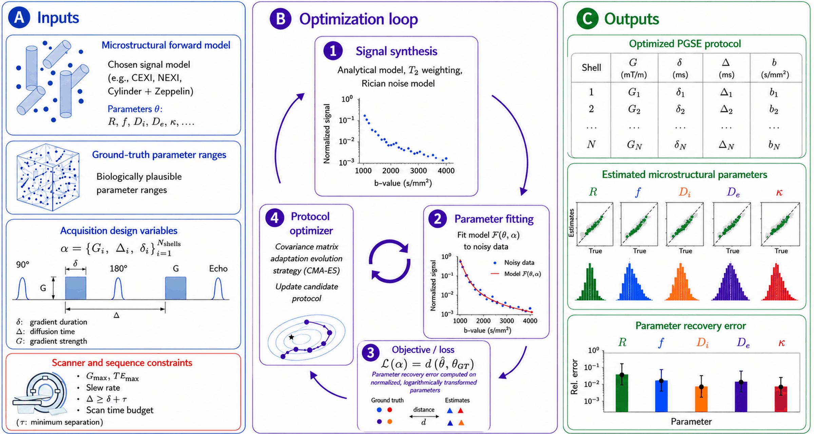

# POLAR - Protocol Optimization via Loss Assessing Parameter Recovery

Diffusion MRI protocol design for reliable parameter recovery: a unified framework across biophysical models

The [tutorial](examples/tutorial.ipynb) shows how to use POLAR.
[CEXI](#example-signal-model-cexi) is demonstrated as an example signal model.

## How it works



## Installation

Python >= 3.10

```bash
git clone https://github.com/ekintaskin/POLAR.git
cd POLAR
python -m venv .venv && source .venv/bin/activate
pip install -e .
```

## Quick start

### From the command line

Copy [cexi_default.yaml](examples/configs/cexi_default.yaml), and set your scanner
limits, noise level and tissue parameters. Then run:

```bash
polar-dmri optimize examples/configs/cexi_default.yaml --output-dir runs/my_protocol

# Evaluate the result; repeat --protocol to compare several under matched noise
polar-dmri evaluate examples/configs/cexi_default.yaml \
    --protocol optimized=runs/my_protocol/best_protocol.csv
```

A protocol CSV needs the columns `delta_ms`, `Delta_ms` and `G_mT_per_m`, with one row
per shell.

### From Python

```python
import polar_dmri as polar

def main():
    model = polar.CEXI(T2=60e-3)
    substrates = polar.make_substrate_grid(
        {"R": [3, 8], "Di": [1e-9], "De": [2e-9], "f": [0.5], "kappa": [5, 30]}
    )

    result = polar.optimize_protocol(
        model,
        substrates,
        n_shells=8,
        constraints=polar.ScannerConstraints(G_bounds=(0.010, 0.080), te_max=100e-3),
        noise=polar.RicianNoise(snr=20, te_ref=70e-3, t2=60e-3),
        loss_parameters=["R", "Di", "De", "f", "kappa"],
        seed=1,
        output_dir="runs/my_protocol",
    )
    print(result.protocol.as_dict())

if __name__ == "__main__": 
    main()
```

All five CEXI parameters are fitted. `loss_parameters` sets which of them count
in the loss.

## What you configure

| Setting | Meaning | Default |
|---|---|---|
| `delta_bounds`, `big_delta_bounds` | Range of δ and Δ | 5–40 ms, 8–50 ms |
| `G_bounds` | Gradient strength range | 10–180 mT/m |
| `min_gap` | Minimum Δ − δ | 3 ms |
| `te_overhead` | TE = δ + Δ + overhead | 10 ms |
| `te_max` | Longest TE | 120 ms |
| `b_max` | Largest b-value | none |
| `snr`, `te_ref`, `t2` | Noise level: σ = exp(−TE_ref / T2) / SNR | 20, 70 ms, 60 ms |
| `n_directions` | Directions averaged per shell | 20 |
| `maxiter` | Most generations | 1000 |
| `min_generations`, `convergence_window` | Stop once the median population loss stops improving between consecutive windows | 100, 50 generations |


## Example signal model: CEXI

CEXI (Cellular Exchange Imaging) models permeable spheres in an extracellular space. Its
parameters are:

| Parameter | Meaning | Unit | Default fit range |
|---|---|---|---|
| `R` | Sphere radius | µm | 1–15 |
| `Di` | Intracellular diffusivity | m²/s | 0.3–2 × 10⁻⁹ |
| `De` | Extracellular diffusivity | m²/s | 1–3.5 × 10⁻⁹ |
| `f` | Intracellular volume fraction | | 0.3–0.85 |
| `kappa` | Membrane permeability | µm/s | 0.001–100 |

### Single radius or radius distribution

Signals are generated from a single radius `R` by default. To generate them from
polydisperse spheres instead, replace `R` with radius distribution files, which have one
radius in µm per line:

```python
substrates = model.make_substrates(
    {"radii_files": ["radii_a.txt", "radii_b.txt"],
     "Di": [1e-9], "De": [2e-9], "f": [0.5], "kappa": [5, 30]}
)
```

In a configuration file, put `radii_files` under `substrates: grid:`, with paths relative
to that file. Spheres contribute to the signal by volume, and exchange uses the
volume-weighted radius. The fit still assumes a single radius, and is scored against the
volume-weighted radius.


## Outputs

An optimization's output directory contains:

| File | Contents |
|---|---|
| `best_protocol.csv` | The final protocol |
| `result.json` | Final loss, stop reason and seed |
| `metadata.json` | All settings and package versions |
| `trace.jsonl` | Best protocol so far, per generation; survives an interrupted run |
| `population.jsonl` | Every candidate and its loss |


## Citation

If you use this software, please cite:

> Taskin E, Rafael-Patiño J, Canales-Rodríguez EJ, Thiran JP. Diffusion MRI protocol
> design for reliable parameter recovery: a unified framework across biophysical models.
> *arXiv preprint* arXiv:2610.28099. 2026. https://arxiv.org/abs/2610.28099


## License

POLAR is available under the GNU Affero General Public License v3.0; see
[LICENSE](LICENSE). The CEXI implementation derives from code under the MIT License.

For use outside the terms of the AGPL, commercial licenses are available.
